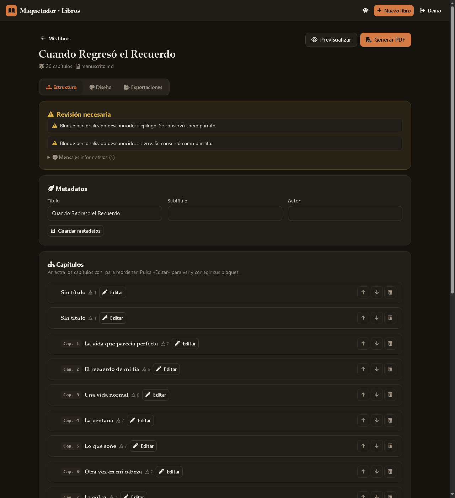

# Maquetador de Libros

  

> 🚧 **Proyecto en desarrollo activo — no es una versión final.** El MVP funciona
> y está probado (36 tests), pero el proyecto **sigue en corrección y mejora
> continua**, con las Fases 6+ pendientes (import DOCX, EPUB, más plantillas,
> portadas, etc.).

Plataforma web donde el usuario sube un manuscrito (.md / .txt) y obtiene un libro maquetado y exportable a PDF, sin depender de IA para funcionar. Pipeline del MVP:

```
Subir Markdown/TXT → Detectar estructura → Mostrar estructura → Editar estructura
  → Elegir plantilla → Previsualizar → Generar PDF
```

## Stack

- **Backend:** PHP 8.3 + Laravel 13 + SQLite (dev) / MySQL (producción)
- **Frontend:** Blade + CSS + JS vanilla (sin frameworks, sin Node)
- **Motor de render PDF:** mPDF (PHP puro, corre en hosting compartido cPanel)
- **Inline markdown:** league/commonmark (determinista, HTML de usuario escapado)

## Capturas

| Dashboard | Editor de estructura |
|-----------|----------------------|
|  |  |

<p align="center"></p>

## Requisitos

- PHP >= 8.3 con extensiones: `mbstring`, `pdo_sqlite` (dev) o `pdo_mysql`, `gd`, `zip`, `intl`, `dom`, `curl`
- Composer

## Instalación (local Windows / Laragon)

```bat
php composer.phar install        # o composer install
copy .env.example .env           # ya configurado con SQLite para dev
php artisan migrate
php artisan serve
```

Con Laragon: `C:\laragon\bin\php\php-8.3.x\php.exe` y `C:\laragon\bin\composer\composer.phar`.

## Generación de PDF (cola)

Las exportaciones van por Laravel Queue con el driver `database`:

```bat
php artisan queue:work           # worker en primer plano (dev)
```

En cPanel (sin daemon): programar `php artisan schedule:run` cada minuto;
`routes/console.php` ya registra `queue:work --stop-when-empty` cada minuto sin solaparse.

## Verificación

```bat
php artisan test                              # suite completa (36 tests)
php scripts\verificar_demo.php                # import → PDF → validación estructural
php scripts\verificar_http.php [base-url]     # flujo HTTP: registro → dashboard
```

La validación del PDF comprueba: existencia, cabecera `%PDF`, `%%EOF`, número de
páginas, tamaño exacto 6×9 in (MediaBox) y fuente embebida. Nunca declarar un PDF
correcto sin estas comprobaciones.

## Arquitectura

```
app/
  DTOs/            BookDocument, ChapterData, BlockData, ImportWarning, ChapterCandidate
  Importers/       BookImporter (interfaz), MarkdownImporter, TxtImporter
  Services/        BookImportService, BookNormalizationService, BookStructureAnalyzer,
                   BookRenderService, PdfExportService, TemplateService
  Jobs/            ProcessExportJob (cola: pending → processing → completed | failed)
  Policies/        BookPolicy (cada usuario accede solo a sus libros)
  Http/Controllers/  Auth, Dashboard, Book, Structure, Design, Export
templates/classic/  template.html · style.css (dialecto mPDF) · metadata.json
```

**Separación estricta:** contenido (modelo interno + BD) independiente del diseño
(plantillas). La plantilla se aplica después de la extracción, nunca durante.

## Reglas de oro implementadas

- **Nunca adivinar en silencio:** los capítulos detectados con confianza
  60–84 % se muestran marcados con su score y el usuario los confirma o rechaza
  (`[Es un capítulo]` / `[Dejar como texto]`).
- **Fidelidad del contenido:** la maquetación no reescribe nada. La
  normalización es solo técnica (BOM, invisibles, saltos, espacios) y queda
  registrada por operación en `book_versions.normalization`.
- **Original intacto:** el manuscrito subido se guarda en
  `storage/app/books/u{user}/original/` y nunca se sobrescribe.
- **Preview = export:** el preview usa exactamente el mismo pipeline
  `BookRenderService → PdfExportService` que el PDF final.
- **TOC con números reales:** mPDF rellena los números tras paginar
  (`tocpagebreak` + `tocentry`); nunca se escriben a mano.
- **Numeración:** sin números en portada y preliminares; arábiga desde el
  capítulo 1 (`resetpagenum`), con arquitectura lista para romanos después.

## Sintaxis personalizada de Markdown (bloques explícitos)

```markdown
:::capitulo num=1 titulo="La vida que parecía perfecta"
Texto del capítulo…
:::

:::epigrafe autor="Julio Cortázar" fuente="Rayuela"
Yo no hago cosas para que duren.
:::

:::salto      ← salto de página
:::separador  ← ornamento tipográfico
```

## Estado del proyecto

🔄 **En desarrollo activo** — se sigue corrigiendo y mejorando constantemente.

- **FUNCIONA y está probado:** MVP completo (Fases 1–5), 36 tests PASS,
  PDF validado end-to-end.
- **PENDIENTE (Fases 6+):** import DOCX, export EPUB/DOCX, más plantillas,
  portadas con imagen, versionado con UI, IA opcional (Fase 8).
- **Pendiente de verificación visual:** revisar el PDF generado
  (`storage/app/demo_export.pdf`) a ojo en el lector de PDF de tu preferencia.

## Licencia

[MIT](LICENSE) © luiyi-lab
